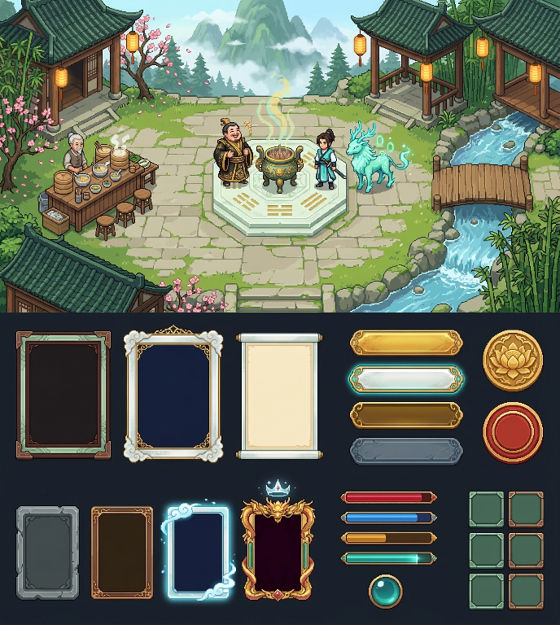
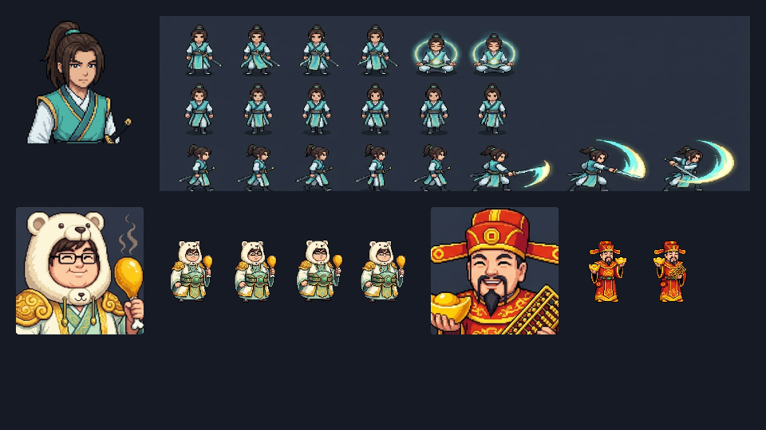
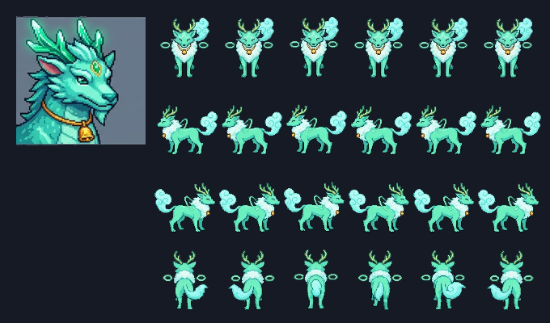
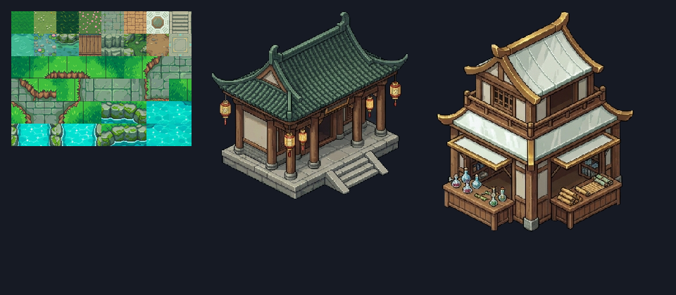
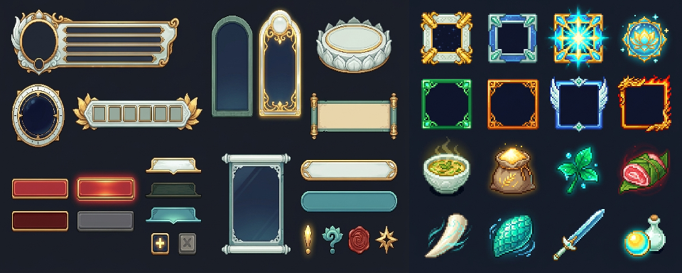
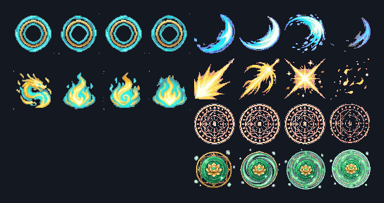

# V01-B Core Kit Library (`assets/corekit/v01b/`)

- **Catalog ID**: `tong-mon-8d-corekit-v01b` (`v1.0.0`, SHA-256 `e716170ec5ce4f36684a2a5871647e8818a8ade7a8b776fb2d36e72f64d9dd63`)
- **Style Direction**: **V01-B — THIÊN MỆNH TIÊN CUNG** (*Three-Tier Progression Grandeur*)
- **Authoritative Catalog**: [`catalog.json`](./catalog.json)
- **Production Profiles**:
  - [`profiles/animation.json`](./profiles/animation.json)
  - [`profiles/ui-tokens.json`](./profiles/ui-tokens.json)
  - [`profiles/world-art.json`](./profiles/world-art.json)

## 1. Authoritative Precedence & Owner Creative Overrides

1. **Main Hero (`v01b.char.hero_kiem_tu` @ `2.0.0-hero-animset-01`, `DEC-009`)**:
   - The current Desktop `HERO-ANIMSET-01` Hero (`assets/sprites/hero_kiem_tu.png` `ecf6604b...` + `assets/portraits/portrait_hero_kiem_tu.png` `1de6fc60...`, derived from `source_04` and native directional sheets `source_h03..h10`) is the active 6-walk-frame Hero master in the repository (`MISSING_APPROVED_HERO_INPUT` remains open for the later owner-confirmed 8-walk-frame Hero artifact, with `full_80x96_20row_8walk` profile support ready in `profiles/animation.json`).
   - Supersedes the older kit Hero (`source_08` / `source_b07`) and intermediate `source_h01` / `source_h02` sheets.
2. **Phì Đế (`v01b.npc.phi_de` @ `2.0.0-bear-hood-chicken`, `DEC-008`)**:
   - Chubby, round-bellied saint-cultivator wearing a **cream bear-head hood with two round ears**, **eyeglasses**, **ivory/celadon-jade saint robes with imperial-gold embroidery**, holding a **boiled chicken drumstick** (`source_b11_phi_de_chubby_luxury_chicken_v01b.png`; strictly no tea/broth cup).
3. **RMT Đế (`v01b.npc.rmt_de` @ `2.0.0-than-tai`, `DEC-008`)**:
   - Distinct crimson-red and imperial-gold **Thần Tài winged official hat**, merchant-god face, red/gold brocade robes, **gold sycee ingot**, and **golden abacus** (`source_b10_phi_de_and_rmt_de_differentiation_v01b.png`).
   - All `archive_pre_correction` variants and `OLD (REJECTED)` comparison panes are archived in `assets/archive/history/` (`role: "archive_only"`, `creativeApprovalState: "REJECTED"`) and blocked by `verify:assets`.

## 2. Visual Master Reference Previews

### 2.1 Style & Tier I Grounded World (`v01b.style.thien_menh_tien_cung`)

### 2.2 Approved Hero, Phì Đế & RMT Đế Masters (`DEC-008`, `DEC-009`)

### 2.3 Quadruped Spirit Beast `ChatDVT` (`v01b.creature.chatdvt`)

### 2.4 `Tân Thủ Thôn` Modular World Kit (`v01b.world.tan_thu_thon_modular_kit`)

### 2.5 Batch A Reusable UI Core Kit (`v01b.ui.batch_a_core_kit`) & Approved Screen Concepts (`v01b.ui.approved_screen_concepts`)

- Owner-approved 8 screen concepts (`references/ui/screens/01_main_world_hud.png` .. `08_mobile_gameplay_layout.png`) and 5 native `S1-ENTRY-VISUAL-REBUILD-01` entry/presentation UI assets (`assets/ui/entry/*`, `assets/ui/presentation/*`) are indexed in [`references/ui/ui_references.json`](./references/ui/ui_references.json).

### 2.6 S1 Core VFX Strips (`v01b.vfx.s1_core_vfx`)

## 3. Mandatory Native Production Workflow

All new visual production work must resolve its `referenceId` and `profileId` from `assets/corekit/v01b/catalog.json` first, invoke the host's native `image-generator` subagent with the resolved master reference image(s), record raw source SHA-256 and tool provenance in `assets/provenance.json`, run deterministic post-processing, and pass `npm run verify:assets` before owner creative review.
